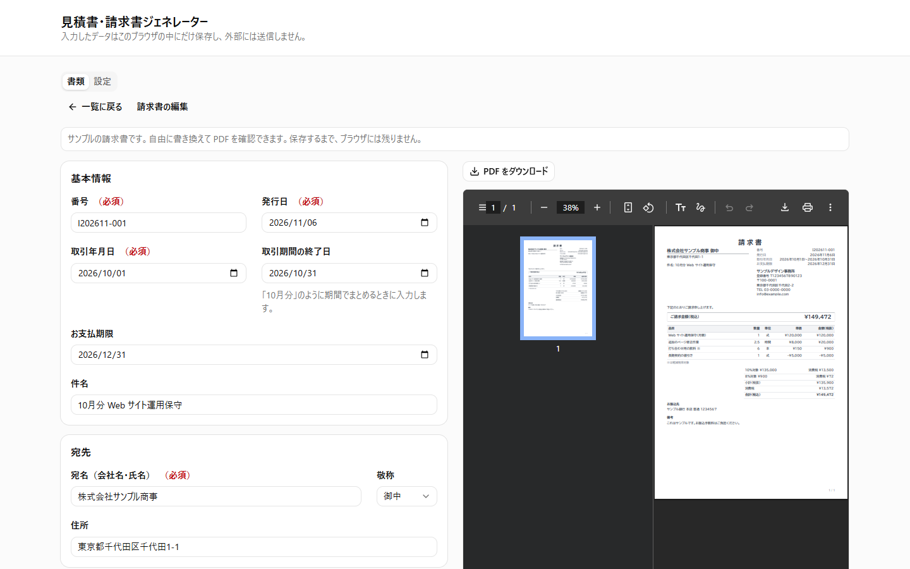
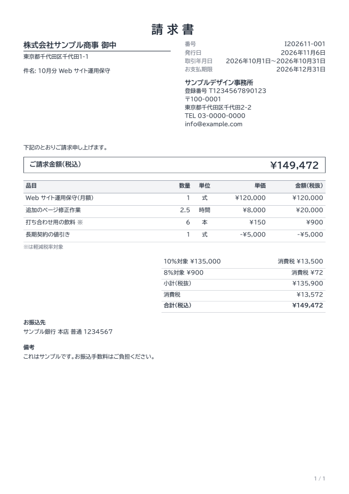

# Estimate & Invoice Generator

English | [日本語](README.md)

A web app that creates Japanese estimates and qualified invoices and exports them as PDF, entirely in the browser. It needs no sign-up, and the data you enter never leaves your browser. The UI is in Japanese only.

**Demo: https://takafumi-masuno.github.io/invoice-generator/** (press 「サンプルで試す」 to see a sample invoice and its PDF without registering anything)



<details>
<summary>Example of the generated PDF</summary>



</details>

## The problem

Under Japan's Qualified Invoice System, which started in October 2023, invoices must meet specific requirements. Small businesses and freelancers run into these problems:

- **Spreadsheet templates make calculation mistakes easy.** Consumption tax must be rounded once per tax rate on each invoice, but rounding on every line gives a different result.
- **Accounting services can be overkill.** They require an account and often a monthly fee, even for a few invoices a month.
- **Business data is sensitive.** Not everyone wants to hand clients and amounts to an outside service.

This app has no server. Calculation, PDF generation, and storage all happen in the browser.

## Features

- Create estimates and invoices with a live PDF preview
- Convert an estimate into an invoice, keeping its line items and rounding settings
- Mix the standard (10%) and reduced (8%) tax rates, and add discount lines with negative unit prices
- Choose how to round (down, up, or half up), separately for line amounts and consumption tax
- Warnings when a qualified invoice requirement is missing
- Warnings for characters that cannot be output to the PDF
- Search, filter, duplicate, and delete documents, with automatic numbering and duplicate checks
- Back up and restore data as a JSON file

## Qualified invoice requirements

How the app covers the requirements in Article 57-4, Paragraph 1 of the Consumption Tax Act:

| Requirement                                                          | Input                                                           | Position in the PDF                                                    |
| -------------------------------------------------------------------- | --------------------------------------------------------------- | ---------------------------------------------------------------------- |
| Issuer's name and registration number                                | 「発行者名」 and 「登録番号」 in settings                       | Issuer block, top right                                                |
| Transaction date                                                     | 「取引年月日」 (plus 「取引期間の終了日」 for a billing period) | 「取引年月日」, top right                                              |
| Description of the transaction, and whether the reduced rate applies | 「品目」 and 「税率」 on each line                              | Line items. Reduced-rate items are marked ※, explained below the table |
| Total per tax rate, and the rate applied                             | Automatic (calculated from the lines)                           | 「10%対象 ¥…」 and 「8%対象 ¥…」 in the totals                         |
| Consumption tax per tax rate                                         | Automatic (calculated from the totals per rate)                 | 「消費税 ¥…」 in the totals                                            |
| Recipient's name                                                     | 「宛名」                                                        | Recipient block, top left                                              |

- Tests extract the text from generated PDFs to confirm all six items (`src/pdf/BillingDocumentPdf.test.tsx`).
- The mapping is defined in `src/domain/qualifiedInvoice.ts`. The editor warns about missing items but still lets you save, so unfinished work is not lost.

### Disclaimer

- This app helps with entering and calculating the required items. It does not guarantee that a document is valid for tax purposes. Consult a tax professional if you are unsure.
- Registration numbers are only checked for format (T followed by 13 digits). They are not looked up in the National Tax Agency's public registry.
- Credit invoices (返還インボイス), corrected invoices, purchase statements, and foreign currency transactions are not supported.

## Design decisions

### Amounts are integers, and calculation uses BigInt

To avoid floating point errors, amounts are stored as whole yen and quantities as integers multiplied by 100 (2.5 → 250). Intermediate products can exceed `Number.MAX_SAFE_INTEGER`, so calculation uses BigInt.

### Consumption tax is rounded once per tax rate

On a qualified invoice, consumption tax is rounded once per tax rate (Order for Enforcement of the Consumption Tax Act, Article 70-10). Any rounding method is allowed, but rounding each line and adding up the results is not. The tax is therefore calculated from the total for each rate (`src/domain/calc.ts`).

### Documents keep a copy of the issuer

An issued document must not change when the settings change later. Each document stores the issuer details from when it was created, and the user decides whether to update them.

### Outdated PDFs cannot be downloaded

Generating a PDF is slow, so the preview updates 0.6 seconds after typing stops. Downloading during that gap would give a PDF of the previous input, so the download button stays disabled until the PDF reflects the latest input.

### Unreadable saved data is never overwritten

Saved data is validated with Valibot on every load. If it cannot be read (it is corrupted, has the wrong shape, or came from a newer version of the app), it is left in place. The user can save the original data to a file, then restore a backup or reset.

### Line breaking and characters in Japanese PDFs

react-pdf is not designed for Japanese typesetting, so the app handles the following:

- **Line breaking:** react-pdf only breaks lines at spaces. The app adds break opportunities between characters and applies Japanese line breaking rules (`src/pdf/lineBreak.ts`).
- **Characters missing from the font:** by default these disappear silently or overlap the next character. A broken recipient name on an invoice is a real problem, so they are replaced with 〓 and the editor shows a warning (`src/pdf/pdfText.ts`).
- **Variation selectors and combining marks:** variation selectors are removed so the standard glyph is used, and combining marks are composed into a single character. Text copied from macOS may contain combining marks.

### Fonts are not subset

Web fonts are often subset to the characters in use, but recipient names can contain rare kanji. Instead, only the hinting data is removed. This cuts the gzipped size by about 19% and leaves the characters, glyphs, and widths unchanged.

### Code that is not on the first screen is lazy-loaded

Total Blocking Time accounted for nearly all of the lost points in the mobile Lighthouse score. The editor and settings are therefore split out and loaded when opened. The first time they open takes longer (with a 4x slower CPU at 1.6 Mbps, 0.1 to 0.7 seconds longer for settings and 0.5 to 1.1 seconds longer for the editor). Preloading the code during idle time was also measured, but it lost about half of the Total Blocking Time improvement, so it is not used.

Loading can fail in an old tab right after a new deployment. To keep the whole screen from going blank, only the failed part shows the reason and a reload button. If the PDF preview fails, the form stays usable with its current input.

## Technology choices

| Technology                                  | Why                                                                                                |
| ------------------------------------------- | -------------------------------------------------------------------------------------------------- |
| Vite / React / TypeScript                   | No server is needed, so data stays in the browser and hosting on GitHub Pages is free              |
| @react-pdf/renderer                         | Generates PDFs in the browser, with layouts written as React components                            |
| React Hook Form / Valibot                   | Handles dynamic forms such as line items, and one schema validates both forms and saved data       |
| Tailwind CSS / shadcn/ui (Radix UI)         | Gives keyboard support and accessible dialogs from the start                                       |
| Vitest / React Testing Library / Playwright | Unit tests cover calculation; a real browser covers user flows and the contents of downloaded PDFs |
| Biome                                       | One fast tool for linting and formatting                                                           |
| GitHub Actions / GitHub Pages               | Only code that passes the tests is deployed from main                                              |

## Quality

GitHub Actions runs these on every push:

- Lint, type checks, and unit and integration tests
- End-to-end tests with Playwright, which check the text of downloaded PDFs
- Accessibility checks with axe on the list, settings, editor, input errors, and confirmation dialog, at desktop and phone widths

Lighthouse (first screen of the public page, 2026-11-06, median of five runs):

|         | Performance | Accessibility | Best Practices | SEO |
| ------- | ----------- | ------------- | -------------- | --- |
| Mobile  | 97          | 100           | 100            | 100 |
| Desktop | 100         | 100           | 100            | 100 |

Mobile Performance depends heavily on the state of the machine running the test. It ranged from 80 to 98 across these five runs, so changes are judged by measuring before and after in turn, not by single values. The medians of seven runs each, before and after lazy loading, were 81 → 87 when the machine was slow and 96 → 97 when it was fast.

Gzipped sizes are about 115 KB of JavaScript for the first screen, about 23 KB loaded when opening the editor or settings, about 468 KB loaded for PDF generation, and about 2.5 MB per font file.

### Known limitations

- End-to-end tests run on Chromium only. The PDF preview has not been verified on iOS Safari.
- Data is stored in the browser's localStorage, so clearing browser data deletes it. Save a backup when needed.
- GitHub Pages cache settings cannot be changed, so Lighthouse's caching suggestions remain.

## Development

```sh
pnpm install
pnpm dev        # dev server
pnpm lint       # Biome
pnpm typecheck  # TypeScript
pnpm test       # Vitest
pnpm test:e2e   # Playwright (run pnpm build first; the first time, run pnpm exec playwright install chromium)
pnpm build      # production build (dist/)
```

To write a PDF generated by the tests to a file, run `PDF_OUTPUT=<path> pnpm test`. Use `-t` to pick a specific test.

Details of the storage format and how to rebuild the fonts are in the [Japanese README](README.md#開発).

## License

- Code: [MIT License](LICENSE)
- Fonts in `public/fonts/`: [SIL Open Font License 1.1](public/fonts/OFL.txt) (not covered by the MIT License)
