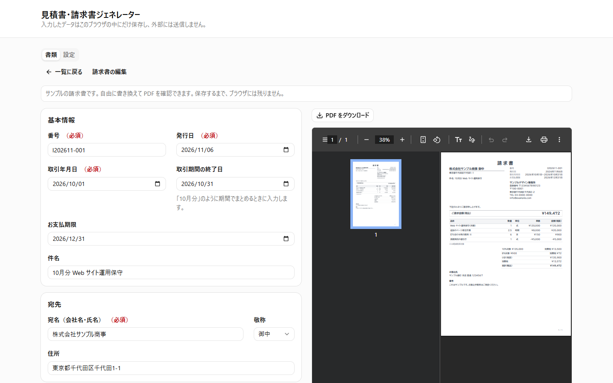
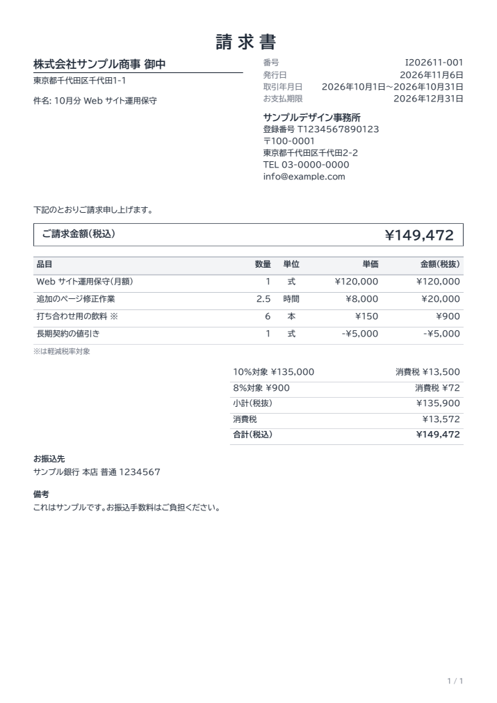

# 見積書・請求書ジェネレーター

[English](README.en.md) | 日本語

ブラウザだけで見積書と適格請求書（インボイス）を作成し、PDF で出力できる Web アプリです。登録は不要で、入力したデータはブラウザの外に送信しません。

**デモ: https://takafumi-masuno.github.io/invoice-generator/** （「サンプルで試す」を押すと、登録なしで請求書と PDF を確認できます）



<details>
<summary>出力される PDF の例</summary>



</details>

## 解決したい課題

小規模な事業者や個人が適格請求書を作るときの、次の問題を解決するために作りました。

- **表計算のテンプレートは計算を間違えやすい**: 消費税の端数処理は「請求書1枚につき、税率ごとに1回」と決まっていますが、明細の行ごとに丸めてしまうと結果が変わります。
- **会計サービスは大げさなことがある**: 月に数枚の請求書のために、登録や月額料金が必要になります。
- **取引の情報を外部に預けたくない**: 取引先や金額は機密情報です。

このアプリはサーバーを持たず、計算から PDF の生成、保存までをすべてブラウザの中で行います。

## 機能

- 見積書・請求書の作成と、リアルタイムの PDF プレビュー
- 見積書から請求書への変換（明細と端数処理を引き継ぐ）
- 標準税率（10%）と軽減税率（8%）の混在、値引き行（マイナスの単価）
- 端数処理の選択（切捨て・切上げ・四捨五入。明細の金額と消費税額で別々に設定）
- 適格請求書の記載事項が足りないときの警告
- PDF に出力できない文字の警告
- 書類の検索・絞り込み・複製・削除、書類番号の自動採番と重複チェック
- データのバックアップ（JSON ファイル）と復元

## 適格請求書の記載事項との対応

消費税法第57条の4第1項が定める記載事項と、このアプリの対応です。

| 記載事項                                       | 入力欄                                                         | PDF の出力位置                                                               |
| ---------------------------------------------- | -------------------------------------------------------------- | ---------------------------------------------------------------------------- |
| 発行者の氏名又は名称及び登録番号               | 設定の「発行者名」「登録番号」                                 | 右上の発行者欄                                                               |
| 取引年月日                                     | 「取引年月日」（まとめて請求する場合は「取引期間の終了日」も） | 右上の「取引年月日」                                                         |
| 取引の内容（軽減税率の対象である旨）           | 明細の「品目」「税率」                                         | 明細の品目。軽減税率の品目には ※ を付け、明細の下に「※は軽減税率対象」と記載 |
| 税率ごとに区分して合計した対価の額及び適用税率 | 自動（明細から計算）                                           | 合計欄の「10%対象 ¥…」「8%対象 ¥…」                                          |
| 税率ごとに区分した消費税額等                   | 自動（税率ごとの合計から計算）                                 | 合計欄の「消費税 ¥…」                                                        |
| 書類の交付を受ける事業者の氏名又は名称         | 「宛名」                                                       | 左上の宛名                                                                   |

- 6項目すべてについて、生成した PDF から文字を取り出して確認しています（`src/pdf/BillingDocumentPdf.test.tsx`）。
- 対応関係は `src/domain/qualifiedInvoice.ts` に定義していて、不足があると編集画面に警告を出します。警告だけで保存は止めません（入力の途中でも保存できるようにするためです）。

### 免責

- このアプリは記載事項の入力と計算を補助するものです。作成した書類が税務上有効であることは保証しません。判断に迷う場合は税理士や税務署に確認してください。
- 登録番号は形式（T と13桁の数字）だけを確認します。国税庁の公表サイトとの照合はしません。
- 返還インボイス、修正インボイス、仕入明細書、外貨建ての取引には対応していません。

## 設計で判断したこと

### 金額は円の整数、計算は BigInt

浮動小数点の誤差を避けるため、金額は円の整数、数量は100倍した整数（2.5 → 250）で持ちます。掛け算の途中で `Number.MAX_SAFE_INTEGER` を超える場合があるので、計算には BigInt を使います。

### 消費税の端数処理は、税率ごとに1回だけ

適格請求書の消費税額の端数処理は、一の適格請求書につき税率ごとに1回です（消費税法施行令第70条の10、消費税法基本通達1-8-15）。方法は任意ですが、明細の行ごとに端数処理して合計することは認められていません。そのため、税額は税率ごとの合計から計算します（`src/domain/calc.ts`）。

### 書類に発行者の情報を保存する

発行済みの書類は、あとで設定を変えても内容が変わってはいけません。書類ごとに作成時点の発行者の情報を持たせ、更新するかどうかは利用者が選びます。

### 古い内容の PDF をダウンロードさせない

PDF の生成は重いので、入力が止まってから 0.6 秒後にプレビューを更新します。その間にダウンロードすると直前の内容の PDF になってしまうため、入力が反映されるまでダウンロードボタンを無効にしています。

### 読めない保存データは上書きしない

保存データは読み込むたびに Valibot で検証します。読み込めないデータ（壊れている、形式が違う、新しいバージョンのアプリで作られた）は上書きせず、画面から元のデータをファイルに保存したうえで、バックアップからの復元か初期化を選べます。

### 日本語 PDF の改行と文字

react-pdf は日本語の組版を想定していないため、次の対応をしています。

- **改行と禁則処理**: 半角スペースでしか改行しないので、文字の間に改行位置を作り、句読点や閉じ括弧が行頭に来ないようにしています（`src/pdf/lineBreak.ts`）。
- **フォントにない文字**: そのままだと文字が黙って消えたり、隣の文字に重なったりします。請求書の宛名が欠けると実害があるので、「〓」に置き換えて編集画面で警告します（`src/pdf/pdfText.ts`）。「𠮷」（つちよし）はこのフォントにありません。
- **異体字セレクタと結合文字**: 異体字セレクタは取り除いて標準の字形で出力し、結合文字の濁点は1文字にまとめます。結合文字は macOS からコピーした文字列などに含まれます。

### フォントは文字を間引かない

Web フォントでは使う文字だけに絞るサブセット化が一般的ですが、宛名には珍しい漢字が入るので行っていません。代わりにヒント情報だけを取り除き、収録文字、字形、字幅を変えずに gzip 後のサイズを約19%減らしました。

## 技術選定

| 技術                                        | 選んだ理由                                                                                 |
| ------------------------------------------- | ------------------------------------------------------------------------------------------ |
| Vite / React / TypeScript                   | サーバーが不要なので、データを外に出さず、GitHub Pages で費用をかけずに公開できる          |
| @react-pdf/renderer                         | ブラウザの中で PDF を生成でき、帳票のレイアウトを React のコンポーネントとして書ける       |
| React Hook Form / Valibot                   | 明細のような動的なフォームを扱える。スキーマをフォームの検証と保存データの検証で共有できる |
| Tailwind CSS / shadcn/ui（Radix UI）        | キーボード操作やダイアログのアクセシビリティを土台から確保できる                           |
| Vitest / React Testing Library / Playwright | 計算は単体テストで、画面の流れとダウンロードした PDF の中身は実際のブラウザで確認する      |
| Biome                                       | lint とフォーマットを1つの高速なツールにまとめられる                                       |
| GitHub Actions / GitHub Pages               | テストに通ったものだけを main から自動で公開する                                           |

## 品質

GitHub Actions で、push のたびに次のものを実行します。

- lint、型チェック、単体・結合テスト
- E2E テスト（Playwright）: ダウンロードした PDF の文字まで確認します
- アクセシビリティの検査（axe）: 一覧、設定、編集画面、入力エラー、確認ダイアログを、PC 幅とスマートフォン幅で検査します

Lighthouse（2026-11-06、公開ページの初回画面）:

|              | Performance | Accessibility | Best Practices | SEO |
| ------------ | ----------- | ------------- | -------------- | --- |
| モバイル     | 92          | 100           | 100            | 100 |
| デスクトップ | 100         | 100           | 100            | 100 |

ファイルサイズ（gzip 後）は、最初の画面の JS が約134KB、PDF を表示するときに遅延読み込みする JS が約468KB、フォントが1ファイル約2.5MBです。最初の画面の JS は約半分が react-dom で、設定タブのフォームも最初から必要なため、これ以上の分割はしていません。

### 未確認のこと・制約

- E2E テストは Chromium だけで実行しています。iOS Safari での PDF プレビューは未確認です。
- データはブラウザの localStorage に保存するので、ブラウザのデータを消すと失われます。必要に応じてバックアップを保存してください。
- GitHub Pages のキャッシュ設定は変更できないため、Lighthouse のキャッシュに関する指摘は残ります。

## 開発

```sh
pnpm install
pnpm dev        # 開発サーバー
pnpm lint       # Biome
pnpm typecheck  # TypeScript
pnpm test       # Vitest
pnpm test:e2e   # Playwright（先に pnpm build を実行し、初回は pnpm exec playwright install chromium）
pnpm build      # 本番ビルド（dist/）
```

`PDF_OUTPUT=<出力先パス> pnpm test` で、テストで生成した PDF をファイルに書き出せます（`-t` でテストを絞ると、そのテストの PDF になります）。

### 保存データの形式

データは localStorage の1つのキー（`invoice-generator:data`）に、バージョン付きの JSON で保存します。形を変えるときは、`src/storage/appData.ts` の `CURRENT_VERSION` を上げ、`migrate()` に古い形からの変換を追加します。

```jsonc
{
  "version": 1,
  "settings": {
    "issuer": { "name": "株式会社サンプル", "registrationNumber": "T1234567890123", "...": "..." },
    "rounding": { "lineAmount": "down", "tax": "down" } // down: 切捨て / up: 切上げ / halfUp: 四捨五入
  },
  "documents": [] // 見積書・請求書
}
```

### フォントの作り直し

`public/fonts/` のフォントは、[BIZ UDPゴシック](https://fonts.google.com/specimen/BIZ+UDPGothic)（Version 1.051）の静的 TTF からヒント情報を取り除いたものです。

```sh
pip install fonttools
python scripts/strip_font_hinting.py <元の.ttf> public/fonts/BIZUDPGothic-Regular.ttf
python scripts/strip_font_hinting.py <元の.ttf> public/fonts/BIZUDPGothic-Bold.ttf
python scripts/generate_font_coverage.py  # 収録文字の一覧（src/pdf/fontCoverage.data.ts）を更新する
```

## ライセンス

- コード: [MIT License](LICENSE)
- `public/fonts/` のフォント: [SIL Open Font License 1.1](public/fonts/OFL.txt)（MIT の対象外です）
